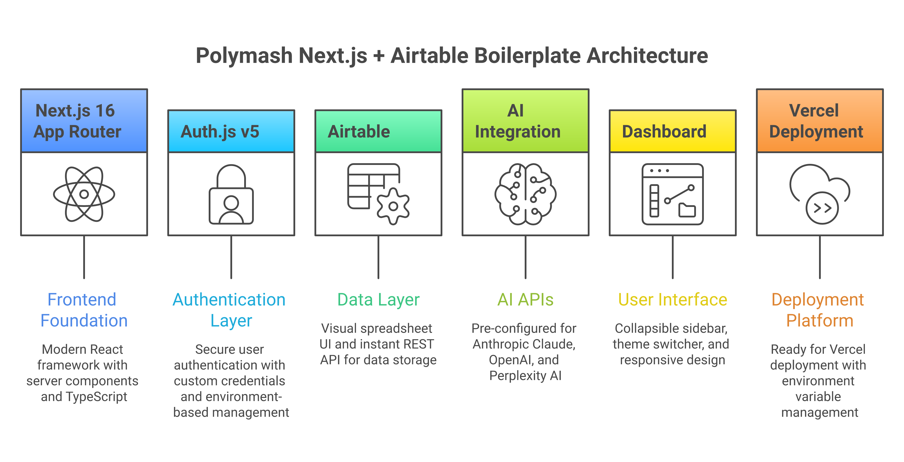

# Polymash Next.js + Airtable Boilerplate

A starter for full-stack apps on **Next.js 16**, **Auth.js v5**, **Airtable** and **shadcn/ui**, without writing a single database migration. Every dependency is pinned to an exact version, so a fresh clone builds the same app the versions table below describes.



## Why Airtable?

Most Next.js starters pair with Supabase, Prisma, or Drizzle. This one uses **Airtable as the primary data store**, and that's the point.

- **Zero migrations**: add fields and tables visually, and the API sees them at once
- **Built-in admin UI**: Airtable is your back office. Filter, sort, bulk edit, share views with non-technical stakeholders
- **Collaborative by default**: your team can work in Airtable while your app reads and writes the same data
- **Rapid prototyping**: go from idea to working app in hours, not days
- **No DevOps overhead**: no database to provision, back up, or scale

This makes it ideal for **internal tools, admin dashboards, AI-powered apps, and MVPs** where speed matters more than scale.

## Features

- **Next.js 16.4**: App Router, React Server Components, TypeScript, `proxy.ts` for route protection
- **Auth.js v5**: credentials sign-in with users listed in an env var (no auth database), 90-day sessions, and a session cookie named per app
- **Airtable**: a client created on first use, so builds work without Airtable keys
- **shadcn/ui**: 13 components installed (sidebar, card, button, dropdown menu, tooltip, sheet, avatar and more), built on the `radix-ui` package
- **Tailwind CSS 4**: dark and light themes
- **Dashboard layout**: collapsible sidebar, theme switcher, mobile sheet
- **AI-ready**: Vercel AI SDK, the Anthropic SDK, an agent registry in `lib/ai/config.ts`, and env slots for Anthropic, OpenAI and Perplexity
- **Vercel-ready**: deploys with no extra configuration

## Versions

Checked and pinned on **2026-11-21**. On that day `npm ci`, `npm run lint` and `npm run build` finished without errors under both Node 24.22.3 and Node 22.18.0, and `npm audit` found 0 vulnerabilities. Against the production build (`next start`), `/login` returned 200, `/` and `/dashboard` sent a signed-out visitor to `/login`, and signing in with a test user set the app's own session cookie for 90 days.

| Layer | Package | Version |
|---|---|---|
| Framework | `next` | 16.4.6 |
| UI runtime | `react`, `react-dom` | 19.3.1 |
| Auth | `next-auth` (Auth.js v5) | 5.0.0-beta.32 |
| Data | `airtable` | 0.12.2 |
| Styling | `tailwindcss`, `@tailwindcss/postcss` | 4.3.5 |
| | `tw-animate-css` | 1.4.0 |
| Components | `shadcn` (CLI and base CSS) | 4.23.0 |
| | `radix-ui` | 1.8.1 |
| | `cn` (class merging) | 0.5.2 |
| Icons | `lucide-react` | 1.77.0 |
| AI | `ai` (Vercel AI SDK) | 7.0.179 |
| | `@ai-sdk/anthropic` | 4.0.107 |
| | `@anthropic-ai/sdk` | 1.12.0 |
| Forms | `react-hook-form` | 7.92.0 |
| | `@hookform/resolvers` | 7.0.8 |
| | `zod` | 4.6.7 |
| Language | `typescript` | 5.9.3 |
| Lint | `eslint` | 9.39.5 |
| | `eslint-config-next` | 16.4.6 |
| Runtime | Node.js | 24.x |
| | `@types/node` | 24.19.2 |

`.npmrc` sets `save-exact=true`, so `npm install <package>` adds an exact version too. Keep it that way: a floating version means a fresh clone can install something the code was never tested against.

The forms packages (`react-hook-form`, `@hookform/resolvers`, `zod`) are installed for the forms you will add; no page uses them yet. The same goes for the two AI SDKs until you register an agent.

### What `npm install` prints, and why it's fine

- **"EBADENGINE Unsupported engine ... required: { node: '24.x' }"** appears when you install with a Node version other than 24. Switch to Node 24 (see Prerequisites) and it goes away.
- **"eslint@9.39.5: This version is no longer supported."** Expected while we stay on ESLint 9; see below.

`package.json` has one `overrides` entry: `minimatch` 11.0.9 under `@ts-morph/common`. The shadcn CLI pulls in `ts-morph`, whose `minimatch` 10 has a denial-of-service advisory ([GHSA-g3hv-75wg-m249](https://github.com/advisories/GHSA-g3hv-75wg-m249)). Remove the override once `shadcn` ships with a fixed `ts-morph`. Do not run `npm audit fix --force`: its "fix" downgrades `shadcn` to 1.0.

### Why these and not newer

- **TypeScript 5.9, not 7.** `typescript-eslint`, which `eslint-config-next` 16.4.6 depends on, accepts TypeScript below 6.1 only, so linting stops on TypeScript 7. Move when `typescript-eslint` supports it.
- **ESLint 9, not 10.** Three plugins inside `eslint-config-next` 16.4.6 (`eslint-plugin-react`, `eslint-plugin-import`, `eslint-plugin-jsx-a11y`) declare support up to ESLint 9 only.
- **`next-auth@beta`, not `next-auth@latest`.** On npm, `latest` is still the old v4. Auth.js v5 is published under the `beta` tag, and its docs install it that way.
- **Node 24.** `package.json` pins `engines.node` to `24.x`, which Vercel follows, and `.nvmrc` says 24 for version managers. Vercel offers 22.x, 24.x and 26.x; 26.x is now its default for new projects. Change `engines.node` and `.nvmrc` together if you move.
- **`@anthropic-ai/sdk` 1.x.** From 1.0 the SDK sends an API version on which every Claude model rejects `temperature`. Nothing here sets one. If you copy older code that does, remove it.

## Origin Story

This boilerplate was inspired by [Bart Slodyczka](https://www.youtube.com/@BartSlodyczka)'s video **["Build 10X Faster With This Simple Claude Code Workflow"](https://www.youtube.com/watch?v=uHpUVBA8dWE)**, which demonstrates using Claude Code to scaffold full-stack apps from a boilerplate foundation. Bart's original [Next.js + Supabase + shadcn/ui boilerplate](https://github.com/Barty-Bart/nextjs-supabase-shadcn-boilerplate) uses Supabase as the data layer. This repo adapts that approach for **Airtable**, trading SQL flexibility for visual data management, instant schema changes, and zero-migration workflows.

We maintain both variants at Polymash:
- **This repo**: Airtable backend (visual data, rapid prototyping, non-technical collaboration)
- [polymash-nextjs-supabase-shadcn-boilerplate](https://github.com/JuergenB/polymash-nextjs-supabase-shadcn-boilerplate): Supabase backend (SQL, row-level security, real-time subscriptions)

## Quick Start

### Prerequisites

- **Node.js 24.** Check with `node -v`; it should print `v24.something`. If it doesn't, pick one way to get it:
  - **Installer:** download the macOS or Windows installer for the newest 24.x release from [nodejs.org/en/download](https://nodejs.org/en/download) (choose version 24 in the version menu) and run it. This replaces the Node you have.
  - **nvm** (keeps several versions side by side): [install nvm](https://github.com/nvm-sh/nvm#installing-and-updating), then in this folder run `nvm install` and `nvm use`. Both read `.nvmrc`.
  - **n** (if you already use it): `sudo n 24`.

  Open a new terminal afterwards and run `node -v` again.
- **An [Airtable](https://airtable.com) account** and a base for this app.

### Setup

1. **Clone the repo and install**
   ```bash
   git clone https://github.com/JuergenB/polymash-nextjs-airtable-boilerplate.git my-app
   cd my-app
   npm install
   ```

2. **Name your app.** Change `name` in `package.json` to your app's name. The session cookie is named after it (see [Session cookie](#session-cookie)).

3. **Create an Airtable personal access token.** Go to [airtable.com/create/tokens](https://airtable.com/create/tokens) and click **Create new token**. Give it a name, add the scopes `data.records:read` and `data.records:write` (plus `schema.bases:read` and `schema.bases:write` if you or Claude Code will create tables and fields through the API), then click **Add a base** and choose your base. Copy the token straight away: Airtable shows it only once.

4. **Configure the environment**
   ```bash
   cp .env.example .env.local
   ```
   Fill in at least these four in `.env.local`:
   ```
   AUTH_SECRET=        # paste the output of: openssl rand -base64 33
   AUTH_USERS=1:admin@example.com:choose-a-password
   AIRTABLE_API_KEY=   # the personal access token from step 3
   AIRTABLE_BASE_ID=   # from your base's URL: airtable.com/appXXXXXX/...
   ```
   Keep `:`, `,`, `$` and `#` out of the passwords in `AUTH_USERS`: the list is split on `:` and `,`, and Next.js treats `$` and `#` specially in env files. Next.js reads `.env.local` by itself; nothing else is needed.

   Don't use `npx auth secret`, which older Auth.js guides suggest. The `auth` package on npm is now the Better Auth CLI, and it does not write `AUTH_SECRET` for you.

5. **Run the dev server**
   ```bash
   npm run dev
   ```
   Open [http://localhost:3000](http://localhost:3000). You land on `/login`; sign in with a user from `AUTH_USERS`.

   To use another port, run `npm run dev -- -p 4000`. Next.js ignores a `PORT` set in `.env.local`, because the server starts before env files are read.

## How auth works

- [auth.ts](auth.ts) configures Auth.js with a credentials provider. Users come from `AUTH_USERS` (`id:username:password`, comma-separated). Sessions are JWTs in a cookie and last 90 days. Nothing rechecks `AUTH_USERS` during a session, so removing a user or changing a password does not sign anyone out. To end every session at once, change `AUTH_SECRET`.
- [proxy.ts](proxy.ts) runs on every request except `/api`, static files and images. Signed-out visitors go to `/login`; signed-in visitors who open `/login` go to `/dashboard/home`.
- `/` and `/dashboard` redirect to `/dashboard/home`.

### Session cookie

Browsers share cookies between ports, and every Auth.js app uses the same default cookie name. So two Auth.js apps running on `localhost:3000` and `localhost:3001` overwrite each other's session and keep logging you out. This boilerplate gives each app its own cookie name:

- If `AUTH_COOKIE_NAME` is set, that is the name.
- Otherwise it is `<name in package.json>.session-token`, for example `my-app.session-token`.

So either rename the package (Setup step 2) or set `AUTH_COOKIE_NAME`. Two apps cloned from this repo and left unrenamed would share the name again. Changing the name signs everyone out once.

### Running the production build yourself

`npm run build && npm start` runs in production mode, where Auth.js only trusts the request's host on Vercel. Anywhere else, add `AUTH_TRUST_HOST=true` to `.env.local` (or to the server's environment). Leave the variable out entirely rather than empty: an empty value turns the check on even in development.

## Project Structure

```
app/
  page.tsx                → Redirects to /dashboard/home
  layout.tsx              → Geist font, session and theme providers
  globals.css             → Tailwind 4 and the shadcn theme (light and dark)
  login/                  → Sign-in page
  dashboard/              → Protected dashboard (sidebar layout)
  api/auth/               → Auth.js route handlers
components/
  app-sidebar.tsx         → Sidebar navigation (customize menu items here)
  logo.tsx                → App logo component
  providers.tsx           → Session and theme providers, toaster
  theme-switcher.tsx      → Dark/light mode toggle
  ui/                     → shadcn/ui components (13 installed)
hooks/
  use-mobile.ts           → Mobile breakpoint, used by the sidebar
lib/
  airtable/client.ts      → getBase() and getTable(), created on first use
  ai/config.ts            → AI agent registry
  utils.ts                → cn() for class names
auth.ts                   → Auth.js v5 configuration
proxy.ts                  → Next.js 16 proxy (formerly middleware)
```

## Customization

| What | Where |
|------|-------|
| Sidebar menu items | `components/app-sidebar.tsx` |
| Theme & colors | `app/globals.css` |
| Auth configuration | `auth.ts` |
| Airtable tables | add `AIRTABLE_<NAME>_TABLE_ID` to `.env.local`, then `getTable("AIRTABLE_<NAME>_TABLE_ID")` |
| AI agents | `lib/ai/config.ts` |
| Add shadcn components | `npx shadcn add [component]` |

`npx shadcn add` uses the shadcn version pinned in `package.json` and the settings in `components.json`. Browse components at [ui.shadcn.com/docs/components](https://ui.shadcn.com/docs/components).

Two lint rules from `eslint-config-next` 16 reject patterns that some generated components and older examples still use: calling `setState` directly inside `useEffect`, and calling `Math.random()` inside `useMemo`. [hooks/use-mobile.ts](hooks/use-mobile.ts) uses `useSyncExternalStore` instead, and the sidebar skeleton uses a `useState` initializer.

### AI models

`lib/ai/config.ts` is where you register each agent with its model, provider and API method. The current Claude models are `claude-opus-5-5`, `claude-sonnet-5-5`, `claude-haiku-5-5` and `claude-fable-5-2`. They reject `temperature` and forced tool calls, and they can think before answering out of the same `max_tokens` budget. Send no temperature, set `effort` explicitly and leave room in `max_tokens`.

## Integrations

The boilerplate has env slots for a curated set of APIs that cover the most common needs when building AI-powered apps. All keys go in `.env.local` (see `.env.example` for the full template). The code reads the Core variables today; the others are slots for integrations you add when an app needs them.

### Core

| Variable | What It Does |
|----------|-------------|
| `AUTH_SECRET` | Required. Encrypts the Auth.js session. Generate with `openssl rand -base64 33` |
| `AUTH_USERS` | Users in `id:username:password` format, comma-separated. No auth database needed |
| `AUTH_COOKIE_NAME` | Optional. Session cookie name, unique per app. Defaults to `<package.json name>.session-token` |
| `AUTH_TRUST_HOST` | Optional. Set to `true` only when running the production build outside Vercel |
| `AIRTABLE_API_KEY` | [Airtable personal access token](https://airtable.com/create/tokens) with access to your base |
| `AIRTABLE_BASE_ID` | Target Airtable base (from the URL: `airtable.com/appXXXXXX/...`) |

### AI

| Variable | What It Does |
|----------|-------------|
| `ANTHROPIC_API_KEY` | [Anthropic Claude](https://console.anthropic.com/): advanced reasoning, content generation, and code. Read by the Anthropic SDK and the AI SDK's Anthropic provider |
| `OPENAI_API_KEY` | [OpenAI](https://platform.openai.com/api-keys): GPT models for chat, embeddings, and structured output |
| `PERPLEXITY_API_KEY` | [Perplexity AI](https://www.perplexity.ai/settings/api): web-grounded research. Perplexity searches the live web and returns cited, up-to-date answers. Useful for research pipelines, fact-checking, and competitor analysis |

### Content & Media

| Variable | What It Does |
|----------|-------------|
| `REPLICATE_API_TOKEN` | [Replicate](https://replicate.com/): dozens of image generation models (Flux, SDXL, etc.) through a single API. Hero images, product shots, backgrounds, and visual content for websites and social media |
| `NAPKIN_API_KEY` | [Napkin AI](https://napkin.ai/): infographics, flowcharts, process diagrams, and explanatory visuals from plain text. Napkin produces structured, editable graphics, good for "how it works" sections and documentation |
| `UNSPLASH_ACCESS_KEY` | [Unsplash](https://unsplash.com/oauth/applications): free high-quality stock photography API |

### Data & Scraping

| Variable | What It Does |
|----------|-------------|
| `FIRECRAWL_API_KEY` | [Firecrawl](https://firecrawl.dev/): structured data from any web page. Handles JavaScript rendering and anti-bot challenges, and returns clean markdown or structured JSON |

### Communications

| Variable | What It Does |
|----------|-------------|
| `RESEND_API_KEY` | [Resend](https://resend.com/): transactional email with React email templates |

## Built With This Boilerplate

These production apps were built on the Polymash boilerplate family, demonstrating what you can ship:

### [Visibility Labs](https://github.com/JuergenB/visibilitylabs-app) ([visibilitylabs.polymash.com](https://visibilitylabs.polymash.com))
AI-powered tools for podcasters and digital strategists to improve online visibility in the age of AI search. Features a GEO & SEO Visibility Audit, About Page Optimizer, Show Description Optimizer, Episode Title Optimizer, and FAQ Generator, all designed to make content citable by ChatGPT, Perplexity, and Google AI Overviews. Built on the [Supabase variant](https://github.com/JuergenB/polymash-nextjs-supabase-shadcn-boilerplate) of this boilerplate. **Demonstrates:** a live, public-facing SaaS product with subscription tools, AI integrations, and a companion [marketing site](https://github.com/JuergenB/visibilitylabs-marketing).

### [Formula One Fantasy Assistant](https://github.com/JuergenB/formula-one-fantasy-assistant)
AI-powered companion for the official F1 Fantasy 2026 game. Multi-archetype team management, streaming AI strategy advisor, 14-source RSS news pipeline with AI relevance scoring, OpenF1 live timing integration, and chip strategy engine. **Demonstrates:** scaling the boilerplate to a complex, real-time, AI-heavy application with Airtable as the data backbone.

### [Polymash Content Audit App](https://github.com/JuergenB/polymash-content-audit-app)
Multi-website content audit and pruning tool. Scores every URL against performance metrics, backlinks, and strategic fit to recommend KEEP, UPDATE, CONSOLIDATE, or DELETE actions. Integrates Google Search Console and DataForSEO. **Demonstrates:** adding external API integrations on top of the boilerplate's auth + Airtable foundation.

### [Artwork Archive Export Utility](https://github.com/JuergenB/artwork-archive)
Automated art submission pipeline for a 501(c)(3) nonprofit. Transforms AI-enriched Airtable data into Artwork Archive-compatible CSV files with visual field mapping, 14 data transforms, and duplicate detection across 40-column contacts and 69-column pieces templates. **Demonstrates:** using the boilerplate as a focused data transformation utility alongside a larger n8n + Airtable automation backend.

## Tech Stack

| Layer | Technology | Version |
|-------|-----------|---------|
| Framework | Next.js (App Router) | 16.4 |
| Language | TypeScript | 5.9 |
| Auth | Auth.js (`next-auth` v5 beta) | 5.0.0-beta.32 |
| Database | Airtable SDK | 0.12.2 |
| UI Components | shadcn/ui on Radix (`radix-ui`) | shadcn 4.23 |
| Styling | Tailwind CSS | 4.3 |
| AI | Vercel AI SDK 7 + Anthropic SDK 1 | see Versions |
| Runtime | Node.js | 24.x |
| Deployment | Vercel | |

## License

MIT
